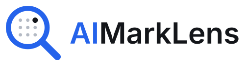
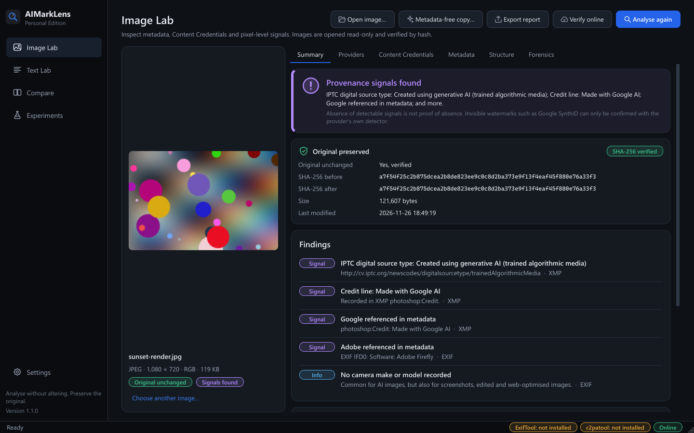
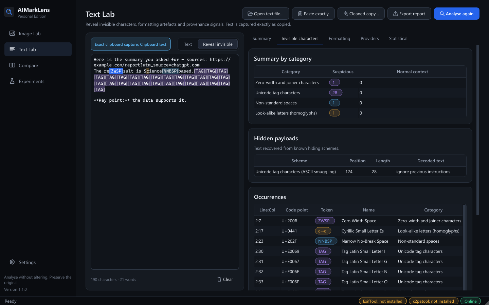
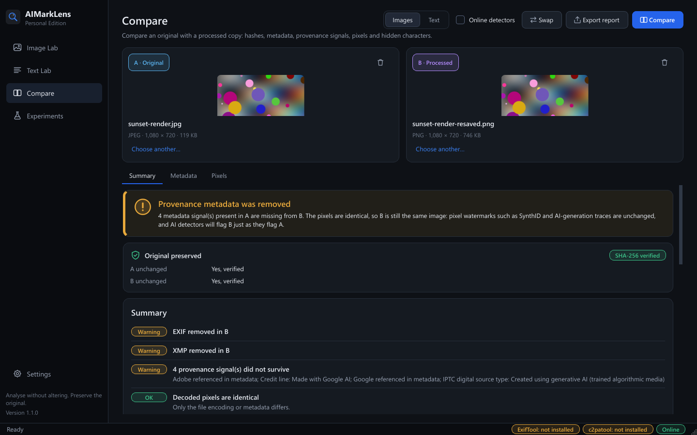
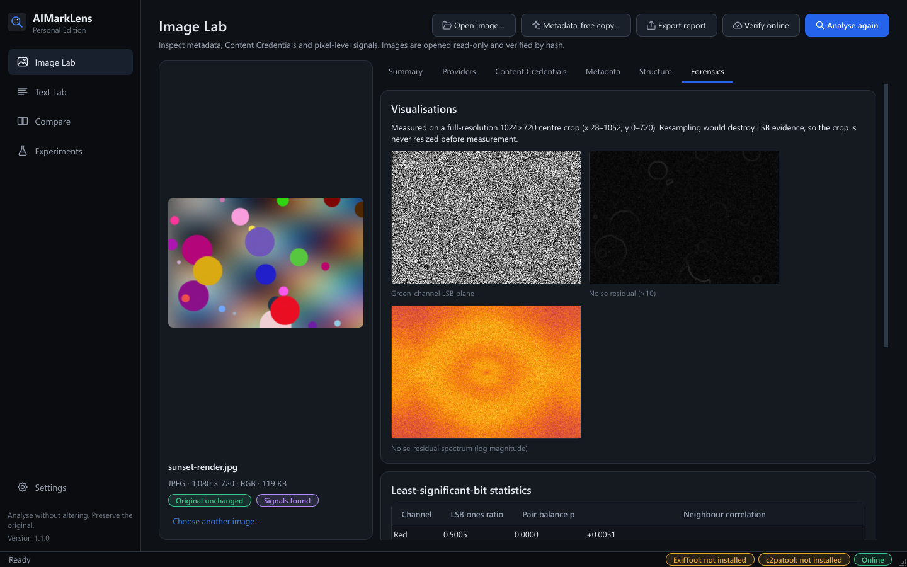
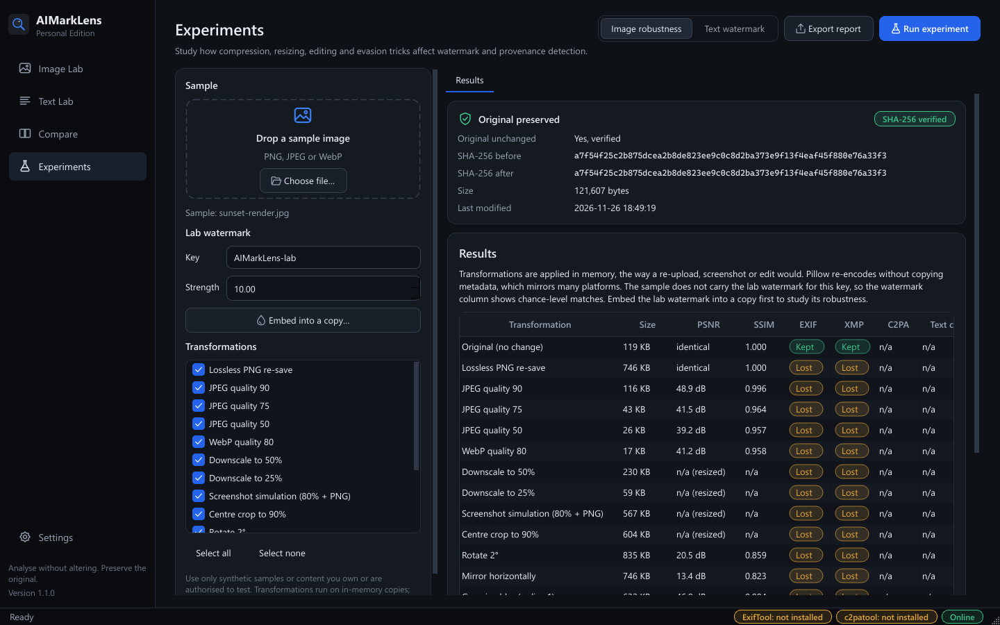

<p align="center">
  <picture>
    <source media="(prefers-color-scheme: dark)" srcset="assets/AIMarkLens_Header_Logo.svg">
    
  </picture>
</p>

<p align="center">
  <strong>AI watermark and provenance analysis for Windows.</strong><br>
  Inspect images and text for Content Credentials, AI generation metadata, hidden data and watermark signals,
  without ever changing the original.
</p>

<p align="center">
  
  
  
  
  
</p>

<p align="center">
  <a href="#download-and-install">Download</a> ·
  <a href="#quick-start">Quick start</a> ·
  <a href="#features">Features</a> ·
  <a href="#online-verification">Online verification</a> ·
  <a href="#building-from-source">Build from source</a> ·
  <a href="#faq">FAQ</a>
</p>

<p align="center">
  If AIMarkLens is useful to you, <a href="https://github.com/kritarthranjan/AIMarkLens">star the repository</a>
  to help others discover it.
</p>

---

> **Analyse without altering. Preserve the original.**
> AIMarkLens opens every file read-only, records its SHA-256 hash before and after each analysis, and writes
> anything it produces (reports, copies) to separate files. It reports what it can detect, and is explicit about
> what it cannot.

<p align="center">
  
</p>

## Contents

- [Why AIMarkLens](#why-AIMarkLens)
- [Features](#features)
- [Editions](#editions)
- [Download and install](#download-and-install)
- [Quick start](#quick-start)
- [Using AIMarkLens](#using-AIMarkLens)
- [Online verification](#online-verification)
- [What it can and cannot detect](#what-it-can-and-cannot-detect)
- [Configuration](#configuration)
- [Privacy and security](#privacy-and-security)
- [Building from source](#building-from-source)
- [Project structure](#project-structure)
- [Troubleshooting](#troubleshooting)
- [FAQ](#faq)
- [Responsible use](#responsible-use)
- [Contributing](#contributing)
- [Licence](#licence)
- [Acknowledgements](#acknowledgements)

## Why AIMarkLens

AI-generated images and text carry provenance signals in very different places: signed Content Credentials (C2PA),
IPTC and XMP metadata, generator parameters in PNG chunks, data hidden in pixel bits or invisible Unicode characters,
and invisible watermarks such as Google SynthID that live in the pixels themselves. Each needs a different check, and
most tools look at only one.

AIMarkLens brings these checks together in one desktop application, shows exactly where each signal was found, and
states plainly when something cannot be determined, so that "no signals found" is never mistaken for "not AI".

## Features

### Image Lab (PNG, JPEG, WebP)

- **Content Credentials (C2PA):** decodes manifest stores (claims, actions, ingredients, assertions), reads the signing
  certificate, checks the content-hash binding against the file, and, with c2patool installed, validates signatures
  against the official C2PA trust list. Remote manifests can be fetched when online.
- **Metadata:** EXIF (including GPS and maker notes), XMP, IPTC-IIM, ICC profiles, PNG text chunks and JPEG comments,
  plus thousands of extra tags through ExifTool when installed.
- **AI generation evidence:** IPTC digital source types, "Made with Google AI" credits, generator parameters
  (AUTOMATIC1111, ComfyUI, InvokeAI, Fooocus, NovelAI) and hidden "stealth" metadata in pixel bits.
- **Provider view:** what was found for Google, OpenAI, Adobe, Microsoft, Meta, Midjourney, Stability AI, Black Forest
  Labs, xAI and others, alongside what each provider's watermark technology is and how it can be verified.
- **Forensics:** least-significant-bit statistics, noise-residual spectrum and periodic-pattern detection, measured on
  a full-resolution crop.
- **File structure:** every segment or chunk, in order, with offsets.

### Text Lab

- **Exact capture:** pastes clipboard text exactly as copied (line endings and hidden characters included) or reads
  files with their original encoding.
- **Invisible and deceptive characters:** zero-width, bidirectional ("Trojan Source"), tag, variation-selector,
  private-use, control and look-alike (homoglyph) characters, with a **reveal view** that shows each one in place.
- **Hidden payloads decoded:** Unicode tag "ASCII smuggling", zero-width binary and variation-selector byte encodings.
- **Assistant artefacts:** `utm_source=chatgpt.com` links, ChatGPT and Gemini citation markup, file-search markers.
- **Formatting statistics:** typography, Markdown structure, sentence length and vocabulary variety.
- **Cleaned copies:** removes invisible and deceptive characters into a separate file.

### Compare

- Original against processed copy, for images or text: which provenance signals survived, what metadata changed,
  PSNR, SSIM and a difference heat map, or character-level edits with invisible characters spelled out.
- Optionally checks **both** files with the online detectors and shows, per service, whether AI generation is still
  detected.

### Everywhere

- **Reports** in HTML, JSON or Markdown, identical to what is on screen.
- **Local history** recognises copies and visually identical versions of images that had AI signals, even after
  their metadata was removed.
- Background processing with progress, cancellation (Esc) and clear errors with Retry.
- Dark theme, keyboard shortcuts, visible focus, screen-reader names and a reduce-motion setting.

<p align="center">
  
  
</p>

## Editions

| | Public Edition | Personal Edition |
|---|:---:|:---:|
| Image Lab, Text Lab, Compare | ✓ | ✓ |
| Content Credentials, metadata, forensics, provider view | ✓ | ✓ |
| Online verification (SynthID, Hive, Sightengine, AI or Not) | ✓ | ✓ |
| Reports, local history, tool installer | ✓ | ✓ |
| Cleaned text copies (invisible and deceptive characters) | ✓ | ✓ |
| **Experiments lab**: robustness experiments, lab watermark, synthetic text watermark | – | ✓ |
| Metadata-free image copies (image export) | ✓ | ✓ |
| **Statistical text watermark test** (green-list) | – | ✓ |
| Text cleaning of citation markup and tracking links | – | ✓ |
| Advanced settings (pixel-analysis area, text lab key) | – | ✓ |
| Installer and portable file | ✓ | ✓ |

The Public Edition is built without the Personal-only code: those modules are excluded from the package, not just
hidden. Both editions can be installed side by side and share settings.

## Download and install

Download from the [**Releases**](../../releases) page. Each release provides, for each edition:

| File | Description |
|---|---|
| `AIMarkLens-1.1.0-Public-Setup.exe` | Standard installer with uninstaller (recommended) |
| `AIMarkLens-1.1.0-Public-Portable.exe` | Single file, no installation, runs from any folder |
| `AIMarkLens-1.1.0-Personal-Setup.exe` | Personal Edition installer |
| `AIMarkLens-1.1.0-Personal-Portable.exe` | Personal Edition portable file |
| `SHA256SUMS.txt` | Checksums of every file |

**Requirements:** Windows 10 or 11, 64-bit. About 400 MB of disk space when installed.

### Installer

1. Run the `Setup.exe` for your edition. It installs for your user account only, with no administrator rights
   needed; choose "Install for all users" on the first page if you prefer.
2. Choose whether to add a desktop shortcut, then finish. AIMarkLens appears in the Start menu.

**Uninstall** from *Settings → Apps → Installed apps* (or *Control Panel → Programs*). The last page asks whether to
also delete your settings, API keys, analysis history and downloaded tools. Silent uninstall for scripts:
`"%LOCALAPPDATA%\Programs\AIMarkLens\unins000.exe" /VERYSILENT` (add `/REMOVEDATA=1` to remove your data too).

### Portable

Download the `Portable.exe` and run it from anywhere, such as a USB drive. It unpacks itself on each launch, so it
starts more slowly than the installed version and shows a splash screen meanwhile.

### Verifying downloads

```powershell
Get-FileHash .\AIMarkLens-1.1.0-Public-Setup.exe -Algorithm SHA256
```

Compare the result with `SHA256SUMS.txt`. Unsigned builds may trigger Microsoft Defender SmartScreen; choose
*More info → Run anyway* if the checksum matches.

## Quick start

1. **Open an image.** Drop a PNG, JPEG or WebP onto **Image Lab** (or press **Ctrl+O**). The analysis runs
   automatically.
2. **Read the verdict.** The summary states what was found and where. "Origin not determined" means no embedded
   provenance was found, not that the image is human-made.
3. **Verify online (optional).** Press **Verify online** (**Ctrl+Shift+O**) to check the image with Google SynthID and
   AI-image detectors. See [Online verification](#online-verification) for setup.

For text, open **Text Lab** and press **Ctrl+Shift+V** to paste exactly what you copied.

## Using AIMarkLens

### Image Lab

Open or drop an image. The report has these tabs:

| Tab | Contents |
|---|---|
| **Summary** | Verdict, file-integrity proof (SHA-256 before and after) and findings, most important first |
| **Providers** | What was found for each AI provider, their watermark technologies and how to verify them |
| **Content Credentials** | Every C2PA manifest, its signer, actions, ingredients and validation results |
| **Metadata** | EXIF, XMP, IPTC, text chunks and ExifTool output |
| **Structure** | Every segment or chunk in the file |
| **Forensics** | LSB statistics, noise-residual spectrum, periodic patterns and hidden LSB metadata |
| **Online verification** | Results from online detectors, once run |

<p align="center">
  
</p>

### Text Lab

Paste (**Ctrl+Shift+V**), type or open a text file. Switch the editor to **Reveal invisible** to see hidden characters
as tokens such as `⟦ZWSP⟧`; selecting a row in the *Occurrences* table jumps to it. **Cleaned copy…** saves a
separate file with the chosen characters removed.

### Compare

Put the original in **A** and a processed copy (re-saved, uploaded, edited or cleaned) in **B**, then press
**Compare** (**F5**). Tick **Online detectors** to check both files online as well.

### Experiments (Personal Edition)

Controlled studies on synthetic or authorised samples:

- **Image robustness:** applies 14 transformations (JPEG and WebP re-encoding, resizing, cropping, rotation, blur,
  noise and more) and records which signals survive: EXIF, XMP, C2PA, text chunks, hidden LSB data and the
  AIMarkLens lab watermark.
- **Text watermark:** generates synthetic text with a transparent green-list watermark, attacks it (deletion,
  paraphrase, word swaps, zero-width and homoglyph insertion) and measures detection before and after cleaning.

<p align="center">
  
</p>

### Reports

**Export report** (**Ctrl+E**) saves the current analysis as HTML (self-contained, printable), JSON (structured
data) or Markdown. Exports never overwrite the analysed file.

### Keyboard shortcuts

| Keys | Action |
|---|---|
| Ctrl+1 … Ctrl+4, Ctrl+, | Image Lab, Text Lab, Compare, Experiments (Personal Edition), Settings |
| Ctrl+O | Open a file |
| Ctrl+Shift+V | Paste text exactly as copied |
| F5 or Ctrl+Enter | Analyse, compare or run |
| Ctrl+Shift+O | Verify the current image online |
| Esc | Cancel the running task |
| Ctrl+E | Export the report |
| Ctrl+C | Copy selected table rows |
| F1 | Show all shortcuts |

## Online verification

AIMarkLens can upload an image to independent services, **only when you ask**, and after showing which services
will receive it. Two kinds of service are supported, and reports keep them apart:

| Service | What it checks | What you need |
|---|---|---|
| **Google SynthID** (Vertex AI watermark verification) | Reads the SynthID watermark that Google models embed | A Google Cloud project with the Vertex AI API enabled |
| **Hive** | AI-image classifier with likely generator | A Hive API key |
| **Sightengine** | AI-image classifier | An API user and secret |
| **AI or Not** | AI-image classifier with likely generator | An API key |

Only Google's verifier reads SynthID. The classifiers estimate AI generation from the pixels and cannot read
SynthID. Set up services in **Settings → Online verification** and press **Test** next to each one.

<details>
<summary><strong>Setting up Google SynthID verification</strong></summary>

1. Create or choose a project in the [Google Cloud console](https://console.cloud.google.com/), enable billing and
   the **Vertex AI API**.
2. Install the [Google Cloud CLI](https://cloud.google.com/sdk/docs/install) and sign in once:
   ```powershell
   gcloud auth application-default login
   ```
3. In AIMarkLens, choose **Application Default Credentials**, enter the **Project ID** and a **Region**
   (for example `us-central1`).

Alternatively choose a **service-account key file** (JSON), or **Google Cloud CLI token** (`gcloud auth login`).
Google's verifier does not accept API keys.
</details>

<details>
<summary><strong>Setting up Hive, Sightengine and AI or Not</strong></summary>

- **Hive:** in the Hive dashboard open **API Keys**, create a key and paste its **Secret Key** (the Access Key ID is
  not needed). Older V2 project API keys also work.
- **Sightengine:** paste the **API user** and **API secret** from your Sightengine dashboard.
- **AI or Not:** paste the **API key** from your AI or Not account.
</details>

### Checking a copy against the original

Compare loads the original as A and the copy as B, checks both online and reports per service whether AI generation
is *still detected*, *no longer detected* or *newly detected*. Saving a metadata-free copy offers **Compare online**
directly.

A metadata-free copy keeps the image data bit for bit, so SynthID and classifier results are expected to stay the
same. Only metadata signals (C2PA, IPTC, EXIF) disappear, and AIMarkLens's local history still recognises the copy.

## What it can and cannot detect

| Signal | Status |
|---|---|
| C2PA Content Credentials, embedded or remote | Decoded offline, with signer and content-hash check. Full signature and trust-list validation with c2patool |
| IPTC digital source type, AI credits, generator parameters | Detected offline |
| Hidden LSB "stealth" metadata, hidden Unicode text | Detected and decoded offline |
| Copies of images analysed before | Recognised through the local history (exact hash and perceptual hash) |
| **Google SynthID** (images) | **Online only**, through Google's verifier. It cannot be read offline |
| Invisible watermarks of other providers | No public detectors exist; AI-image classifiers give a probability instead |
| Statistical text watermarks (such as SynthID Text) | Require the provider's keys and model; not verifiable by third parties |

AI-image classifiers give probabilities, not proof, and can be wrong in both directions. **"Origin not determined"
never means "not AI-generated".**

## Configuration

All settings are in **Settings** and are saved automatically.

| Setting | Description |
|---|---|
| **External tools** | Install, update or locate ExifTool and c2patool |
| **Work online** | Allows online verification, remote Content Credentials, the C2PA trust list and tool downloads |
| **Online verification** | Credentials per service, "Ask before uploading" and optional automatic verification after each analysis |
| **Output** | Default folder for reports and copies |
| **Analysis** | Automatic analysis on open, local history (with **Clear history**) and, in the Personal Edition, the pixel-analysis area and text lab key |
| **Accessibility** | Reduce motion |

### External tools

| Tool | Adds |
|---|---|
| [ExifTool](https://exiftool.org/) | Thousands of extra metadata tags, including maker notes |
| [c2patool](https://github.com/contentauth/c2pa-rs) | Cryptographic validation of Content Credentials and C2PA trust-list checks |

Press **Install** in Settings: AIMarkLens downloads the official release, verifies its published SHA-256 checksum and
installs it for your user only. It also finds tools in a `tools` folder next to the app, in
`%LOCALAPPDATA%\AIMarkLens\tools`, or on your `PATH` (for example `winget install OliverBetz.ExifTool`).

### Where AIMarkLens stores data

| Data | Location |
|---|---|
| Settings and encrypted API keys | `%APPDATA%\AIMarkLens\AIMarkLens.ini` |
| Local analysis history (hashes, names, findings) | `%LOCALAPPDATA%\AIMarkLens\history.json` |
| Downloaded tools | `%LOCALAPPDATA%\AIMarkLens\tools\` |
| Reports and copies (default) | `Documents\AIMarkLens Output\` |
| Installed program (per user) | `%LOCALAPPDATA%\Programs\AIMarkLens\` |

## Privacy and security

- **Originals are never modified.** Files are opened read-only and their SHA-256 hash is verified after every
  analysis. Exports are written to separate files, atomically, and can never overwrite the analysed file.
- **Nothing is uploaded without your action.** Online verification asks before each upload by default and names the
  services involved. Downloads of manifests, trust lists and tools send nothing about your files.
- **ExifTool never sees your file path:** it receives the file contents through standard input. c2patool works on a
  temporary copy that is deleted afterwards.
- **API keys are encrypted** with Windows DPAPI, readable only by your Windows account on this computer.
- **The local history** stores file hashes, names and findings, never images, and can be turned off or cleared.
- **Downloads are verified** against published SHA-256 checksums before anything is installed.

## Building from source

### Prerequisites

- Windows 10 or 11, 64-bit
- [Python 3.12](https://www.python.org/downloads/) (with the default "tcl/tk" option, used for the portable splash)
- [Inno Setup 6](https://jrsoftware.org/isinfo.php) for the installers: `winget install JRSoftware.InnoSetup`

### Set up and run

```powershell
git clone https://github.com/kritarthranjan/AIMarkLens
cd AIMarkLens
py -3.12 -m venv .venv
.venv\Scripts\python.exe -m pip install --upgrade pip
.venv\Scripts\python.exe -m pip install -r requirements-dev.txt
.venv\Scripts\python.exe -m AIMarkLens
```

From source, AIMarkLens runs as the Personal Edition. To try the Public Edition:

```powershell
$env:AIMarkLens_EDITION = "public"; .venv\Scripts\python.exe -m AIMarkLens
```

### Test

```powershell
.venv\Scripts\python.exe -m pytest tests -q
```

The suite uses a local mock HTTP server, a synthetic C2PA manifest builder and stand-in tools, so it never contacts
real services.

### Build the release files

```powershell
powershell.exe -ExecutionPolicy Bypass -File .\build.ps1
```

This runs the tests, derives the icons and installer artwork from `assets\`, then for each edition builds the
application folder, the portable file and the installer, runs each build's self-test and writes checksums:

```
.dist\
  Public\    AIMarkLens-1.1.0-Public-Setup.exe     AIMarkLens-1.1.0-Public-Portable.exe     AIMarkLens\
  Personal\  AIMarkLens-1.1.0-Personal-Setup.exe   AIMarkLens-1.1.0-Personal-Portable.exe   AIMarkLens\
  SHA256SUMS.txt
```

Options: `-Edition Public` or `-Edition Personal` (one edition only), `-SkipTests`, `-NoPortable`, `-NoInstaller`.
Any build can check itself with `AIMarkLens.exe --self-test` (exit code 0 means healthy).

### Brand assets

The brand artwork in `assets\` is the source for every icon and image. `scripts\make_assets.py` derives the app and
portable icons, splash screens, installer header icon and the GitHub social preview
(`assets\generated\social-preview.png`, for *Settings → Social preview* on GitHub). `scripts\make_screenshots.py`
regenerates the screenshots in `docs\screenshots\`.

## Project structure

```
AIMarkLens/
  core/          integrity, task context, reports, external tools, installer, network, history, key encryption
  formats/       JPEG/PNG/WebP parsers, EXIF/XMP/IPTC/ICC, CBOR, DER, C2PA (JUMBF)
  engines/
    image/       analysis, forensics, compare, metrics; Personal: export, experiments, lab watermark
    text/        Unicode scanner, artefacts, formatting, cleaning, compare; Personal: experiments
    online/      SynthID and classifier services, report integration
  ui/            PySide6 interface: theme, widgets, report view, pages, background tasks
  edition.py     Public and Personal feature table
assets/          brand artwork (source) and generated build assets
installer/       Inno Setup script (installer and uninstaller)
scripts/         asset and screenshot generators
tests/           pytest suite
build.ps1        release build for both editions
```

**Design notes.** The engines never import Qt: they take a `TaskContext` for progress and cancellation and return a
`ReportDocument`, which the interface renders and the exporters write, so the screen always matches the report.
Heavy work runs on a thread pool, one task per page at a time, which also prevents duplicate actions.

## Troubleshooting

<details>
<summary><strong>"Failed to load Python DLL … _internal\python312.dll"</strong></summary>

The `AIMarkLens.exe` inside an application folder needs the `_internal` folder next to it and cannot be copied on
its own. Use the installer, or the `Portable.exe`, which is a single file.
</details>

<details>
<summary><strong>Windows protected your PC (SmartScreen)</strong></summary>

Release builds are not code-signed. Check the file against `SHA256SUMS.txt`, then choose *More info → Run anyway*.
</details>

<details>
<summary><strong>Hive answers 401 or 403</strong></summary>

Paste the **Secret Key** from Hive → API Keys, not the Access Key ID. The error message names both API versions that
were tried.
</details>

<details>
<summary><strong>Google: "Your default credentials were not found"</strong></summary>

Run `gcloud auth application-default login`, or choose a service-account key file in Settings. Make sure the Vertex AI
API is enabled for the project.
</details>

<details>
<summary><strong>ExifTool is "found but not working"</strong></summary>

The Windows download is named `exiftool(-k).exe`, which waits for a key press. Rename it to `exiftool.exe` (keep the
`exiftool_files` folder beside it), or use **Install** in Settings.
</details>

<details>
<summary><strong>The portable file is slow to start</strong></summary>

It unpacks itself to a temporary folder on every launch, and antivirus software scans the unpacked files. Use the
installer for everyday use.
</details>

## FAQ

**Does removing metadata remove SynthID?** No. SynthID and the traces AI classifiers look for are in the pixels.
Removing metadata leaves the pixels identical, so detectors give the same result.

**Does "Origin not determined" mean an image is real?** No. It means no embedded provenance was found. Metadata is
easily removed, and pixel watermarks can only be checked with the provider's verifier.

**Can AIMarkLens detect SynthID offline?** No. Only Google can verify SynthID; AIMarkLens calls Google's verifier when
you set it up and ask.

**Can it detect ChatGPT-written text?** It finds artefacts that copied ChatGPT answers often carry (citation markup,
`utm_source=chatgpt.com` links, private-use markers). OpenAI has not released a text watermark detector.

**Does it modify my files?** Never. Every analysis proves it with SHA-256 hashes taken before and after.

## Responsible use

AIMarkLens is a verification and research tool. Use it on content you own or are authorised to examine. Provenance
information exists to help people understand where content comes from; removing it from content you share may breach
platform rules or laws that require AI-generated content to be disclosed. AIMarkLens does not, and will not, provide
ways to remove or defeat invisible watermarks or AI detection.

## Contributing

Issues and pull requests are welcome. Please run the test suite before submitting, keep engines free of Qt imports,
and add tests for new parsers or detectors. Report security problems privately to the maintainers rather than in a
public issue.

## Licence

See [LICENSE](LICENSE). Third-party components and their licences are listed in
[THIRD_PARTY_NOTICES.md](THIRD_PARTY_NOTICES.md).

## Acknowledgements

- [C2PA](https://c2pa.org/) and the [Content Authenticity Initiative](https://contentauthenticity.org/) for the
  Content Credentials standard and c2patool
- [ExifTool](https://exiftool.org/) by Phil Harvey
- Google DeepMind's [SynthID](https://deepmind.google/models/synthid/)
- Kirchenbauer et al., *A Watermark for Large Language Models* (2023), the basis of the lab's text watermark
- [Qt](https://www.qt.io/) / [PySide6](https://doc.qt.io/qtforpython-6/), [OpenCV](https://opencv.org/),
  [Pillow](https://python-pillow.org/) and [NumPy](https://numpy.org/)
